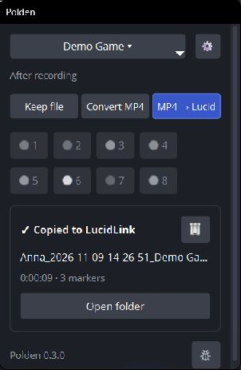

# Polden OBS

**Снимайте геймплей. Отмечайте удачные моменты. Передавайте готовые файлы команде.**

Polden OBS — сборка OBS Studio для коллег, которые записывают игровые футажи. Она сохраняет привычную запись в OBS и добавляет панель игр: после дубля можно автоматически подготовить MP4 и скопировать его вместе с маркерами в папку проекта на LucidLink.

[Скачать для Windows x64](https://github.com/VslyDream/Polden-OBS/releases/latest) · [Что нового в 0.3.0](docs/polden/releases.md) · [Сообщить об ошибке](https://t.me/Vsly_Dream)



## Один раз настроить

1. Скачайте ZIP из **Releases**, полностью распакуйте его в папку с правом записи и запустите `Polden OBS/bin/64bit/obs64.exe`.
2. Проверьте профиль записи и захват игры. Чистая установка содержит **Polden Gameplay**: 1920×1080, 60 FPS, NVENC HEVC Main10/CQP 22 и только игровой звук. Для этого пресета нужен совместимый NVIDIA NVENC; для другого оборудования выберите кодировщик в OBS.
3. В панели **Polden** откройте меню игры → **Add game…**. Выберите папку игры на подключённом LucidLink, проверьте имя, папку видео, источник **Game Capture** и окно игры. Для локальной записи LucidLink не нужен.
4. В **⚙ → Files** впишите своё имя и проверьте шаблоны имени файла и папки. В **Advanced → FFmpeg** должен быть найден или указан рабочий `ffmpeg.exe` для обработки MP4.
5. В **⚙ → Markers** назначьте сочетания для нужных цветов. Клик по цвету включает его кнопку на панели. На новой установке сочетания и кнопки маркеров не заданы.

Если панель скрыта, включите **Docks → Polden**. Названия кнопок ниже приведены как в английском интерфейсе.

## Каждый дубль

Выберите игру и действие **After recording**, проверьте картинку и звук, начните запись привычной кнопкой OBS или своим шорткатом. В стандартном пресете старт/стоп — **Alt+F1**: не назначайте его одновременно маркеру.

| Режим | Что произойдёт после остановки |
| --- | --- |
| **Keep file** | Останется исходная запись и TXT, если были маркеры. |
| **Convert MP4** | Polden подготовит локальный MP4 и положит маркеры рядом. |
| **MP4 → Lucid** | Подготовит MP4 и скопирует его с маркерами в папку игры на LucidLink. |

Во время записи ставьте маркеры горячими клавишами или цветными кнопками. После остановки дождитесь завершения обработки в карточке дубля; **Open folder** откроет папку с доступным результатом. Игра и режим фиксируются при старте: изменения во время записи относятся к следующему дублю.

## Что получает команда

Видео сохраняет исходное имя и время записи. «Convert MP4» меняет контейнер через FFmpeg без перекодирования: качество и видеокодек сохраняются. HEVC не становится H.264.

```text
Anna_2026-11-09-14-32-10_Demo Game.mp4
Anna_2026-11-09-14-32-10_Demo Game.txt
```

TXT появляется после первого маркера и хранит время и цвет, например `0:01:24,1`. Паузы исключаются; у каждого сегмента время начинается с нуля. Автоматического импорта видео или маркеров в Premiere в этой сборке нет.

## Если что-то пошло не так

- **Ошибка обработки:** проверьте FFmpeg, подключение LucidLink и права на папку, затем нажмите **Retry**. Исходная запись сохраняется. Файл с тем же именем и другим содержимым не перезаписывается.
- **Cancel:** окончательно останавливает текущую обработку и незавершённую очередь; исходники и готовые файлы остаются. Возобновления отменённой очереди нет.
- **Delete last take…:** удаляет все сегменты последнего дубля выбранной игры и их маркеры. Локальные файлы идут в Корзину, копии на LucidLink удаляются насовсем — проверьте список в подтверждении.
- **Обновление:** используйте плашку новой версии в Polden или проверку в меню **Help**. Во время записи и обработки установка недоступна; настройки и дополнительные плагины сохраняются.

## Варианты этой инструкции

Это первый черновик README для команды. Можно выбрать подачу и доработать её:

- **A — [короткий старт](README.md)**: эта страница, минимум чтения перед съёмкой.
- **B — [инструкция со скриншотами](docs/polden/readme/README-screenshots.md)**: настройки и действия по шагам.
- **C — [инструкция с GIF](docs/polden/readme/README-gifs.md)**: короткие демонстрации работы панели.

Снимки сделаны в отдельной демонстрационной конфигурации 0.3.0. Имена и пути учебные; доставка показана в локальную папку вместо рабочего LucidLink.

## О проекте

Polden OBS **0.3.0**, база **OBS Studio 32.2.2**. Публичная сборка этого выпуска — Windows x64; старые macOS-артефакты относятся к прежнему выпуску.

[Исходный README OBS](README.rst) · [Сборка Windows](docs/polden/build-windows.md) · [Пайплайн](docs/polden/project-pipeline.md) · [Маркеры](docs/polden/markers.md) · [Лицензия GPL-2.0-or-later](COPYING)
