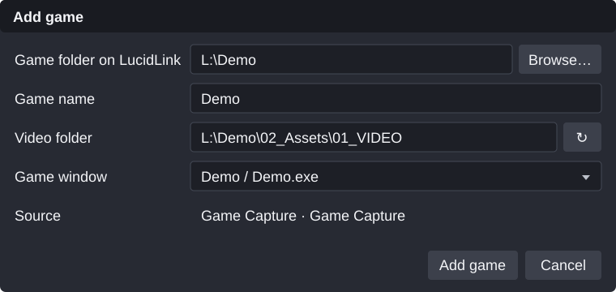
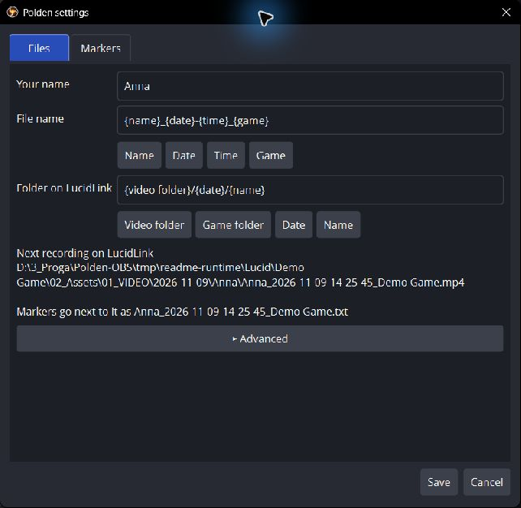

# Polden OBS

Polden OBS автоматически готовит MP4 после записи геймплея и копирует его в папку выбранной игры на LucidLink. FFmpeg переносит видео и звук в контейнер MP4 без перекодирования. Имя файла, время в названии и качество записи сохраняются.

**[Скачать для Windows x64](https://github.com/VslyDream/Polden-OBS/releases/latest)**

## Первый запуск

1. Распакуйте ZIP целиком в папку с правом записи и запустите `Polden OBS/bin/64bit/obs64.exe`.
2. Проверьте картинку и игровой звук в OBS. На чистой установке профиль **Polden Gameplay** пишет в Full HD при 60 кадрах/с с игровым звуком. Для него нужен NVIDIA NVENC с поддержкой HEVC Main10. Если у вас другой кодировщик, выберите его в настройках вывода OBS.
3. Для доставки подключите LucidLink. На панели **Polden** откройте меню игр → **Add game…** и выберите папку игры. Проверьте предложенную папку для видео и окно захвата. Если панель скрыта, откройте **Docks → Polden**.
4. В **⚙ → Files** укажите своё имя и проверьте пример пути под шаблонами. Если Polden не нашёл FFmpeg, откройте **Advanced** и укажите путь к `ffmpeg.exe`.

<strong>Настройки файлов — имя записи, папка на LucidLink и FFmpeg</strong>

Откройте **⚙ → Files** до начала записи. Кнопки под полями вставляют в шаблон имя, дату, время или название игры.

| Поле | Пример | Что получится |
| --- | --- | --- |
| **Your name** | `Anna` | Это имя подставится вместо `{name}`. |
| **File name** | `{name}_{date}-{time}_{game}` | После конвертации файл будет называться, например, `Anna_2026-11-20-14-30-00_Demo.mp4`. Расширение добавляется автоматически. |
| **Folder on LucidLink** | `{video folder}/{date}/{name}` | В папке видео выбранной игры MP4 попадёт в подпапку `2026-11-20\Anna`. |

В **Next recording on LucidLink** проверьте полный путь. В **Advanced** можно указать путь к `ffmpeg.exe` и изменить правила, по которым Polden предлагает имя игры и папку видео при выборе её каталога. Нажмите **Save**, чтобы применить настройки.

## Запись и доставка

Перед записью выберите игру и режим **After recording**. Режим запоминается при старте дубля.

| Если нужен | Выберите | После остановки записи |
| --- | --- | --- |
| Только исходник | **Keep file** | Файл останется в папке записи OBS. |
| MP4 на компьютере | **Convert MP4** | Polden сохранит локальную копию в MP4 и оставит исходную запись. |
| MP4 на LucidLink | **MP4 → Lucid** | Polden подготовит локальный MP4 и скопирует его в папку игры по шаблону из **Files**. |

Начните и остановите запись кнопкой OBS или своим сочетанием клавиш. В стандартном профиле это **Alt+F1**. Когда в карточке появится **Copied to LucidLink**, нажмите **Open folder**, чтобы открыть папку с готовым файлом.

Если обработка завершилась ошибкой, проверьте путь к FFmpeg, подключение LucidLink и права на папку. Затем нажмите **Retry**. Исходная запись сохраняется.

## Цветные маркеры для Premiere Pro

Во время записи можно отметить нужный момент горячей клавишей. Polden сохранит время и цвет в TXT рядом с видео, а совместимый плагин Premiere Pro сможет перенести отметки на клип.

**[Настроить маркеры и узнать об импорте в Premiere Pro →](docs/polden/markers.md)**

---

[История версий](docs/polden/releases.md) · [Техническая документация](POLDEN.md) · [Лицензия](COPYING) · [Сообщить об ошибке](https://t.me/Vsly_Dream)
