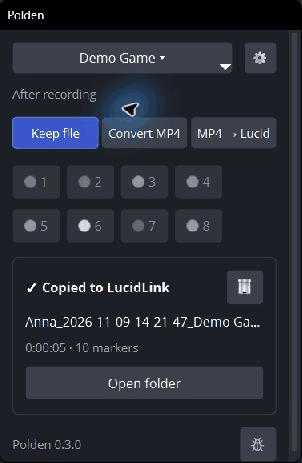
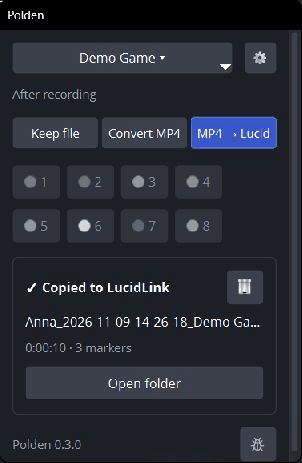
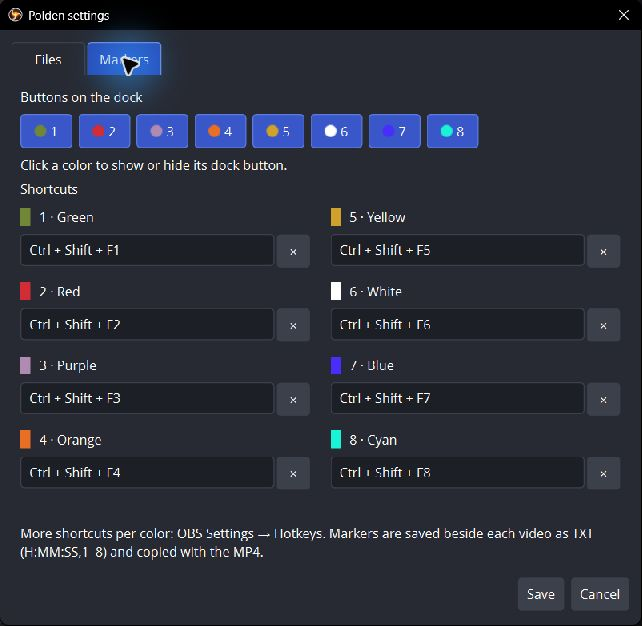

# Polden OBS — посмотрите и повторите

**Вариант C · короткие GIF вместо длинной инструкции.** [Сравнить варианты](../../../README.md#варианты-этой-инструкции)

Вы снимаете геймплей, Polden готовит MP4 и копирует его с маркерами в папку игры на LucidLink. Это OBS Studio с дополнительной панелью для работы с дублями.

[Скачать Windows x64](https://github.com/VslyDream/Polden-OBS/releases/latest) · [Настроить по скриншотам](README-screenshots.md) · [Сообщить об ошибке](https://t.me/Vsly_Dream)

## Выберите игру и режим

Перед стартом выберите игру. В **After recording** доступны:

- **Keep file** — оставить исходник.
- **Convert MP4** — подготовить локальный MP4.
- **MP4 → Lucid** — подготовить MP4 и скопировать его с маркерами на LucidLink.

В меню игры — **Add game…** для новой игры и **Edit…** для проверки папки и захвата. Если панель скрыта, включите **Docks → Polden**.

## Запишите дубль и поставьте маркеры

Начните запись кнопкой OBS или назначенным шорткатом. Ставьте цветные маркеры в нужных местах. Остановите запись и дождитесь завершения обработки в карточке. **Open folder** открывает доступные файлы.

Игра и режим запоминаются при старте: переключение во время записи влияет на следующий дубль. На GIF показана тестовая сцена; доставка идёт в локальную папку, заменяющую LucidLink.

## Что настроить перед первой съёмкой

1. Распакуйте ZIP полностью и запустите `Polden OBS/bin/64bit/obs64.exe`.
2. Проверьте профиль, папку записи, картинку и игровой звук. Пресет чистой установки: Full HD/60 FPS, NVENC HEVC Main10/CQP 22, только звук игры. Нужен совместимый NVIDIA NVENC; другое оборудование требует настройки кодировщика.
3. Добавьте игру, папку проекта, источник Game Capture и окно. Для доставки подключите LucidLink с правом записи.
4. В **⚙ → Files** укажите своё имя, шаблон файла и папку назначения. В **Advanced → FFmpeg** проверьте путь к `ffmpeg.exe`.
5. В **⚙ → Markers** задайте сочетания и включите нужные кнопки цветов. По умолчанию они не заданы. В стандартном пресете **Alt+F1** занят стартом/остановкой записи.

## Как выглядит результат

MP4 сохраняет имя исходной записи; рядом лежит одноимённый TXT, если вы ставили маркеры. В TXT — время и номер цвета 1–8. Например, `0:01:24,1` — зелёный маркер на 1:24.

Подготовка MP4 выполняется без перекодирования и сохраняет качество и исходный видеокодек. Автоматического импорта в Premiere нет: видео и TXT передаются дальше как файлы.

## Три полезных правила

- При ошибке проверьте FFmpeg, LucidLink и права на папку, затем **Retry**. Исходник сохраняется, конфликтующий файл не перезаписывается.
- **Cancel** окончательно отменяет активную обработку и незавершённую очередь. Готовые файлы и исходники остаются; возобновления отмены нет.
- **Delete last take…** удаляет все сегменты последнего дубля: локальные файлы — в Корзину, копии LucidLink — насовсем. Проверьте список перед подтверждением.

Обновляйтесь через плашку в Polden или проверку в Help после завершения записи и обработки. Настройки сохраняются.

---

Polden OBS 0.3.0 / OBS Studio 32.2.2. GIF собраны из снимков настоящего интерфейса в отдельной демонстрационной конфигурации. [Короткая памятка](../../../README.md) · [Пошаговая инструкция](README-screenshots.md) · [Лицензия](../../../COPYING)
