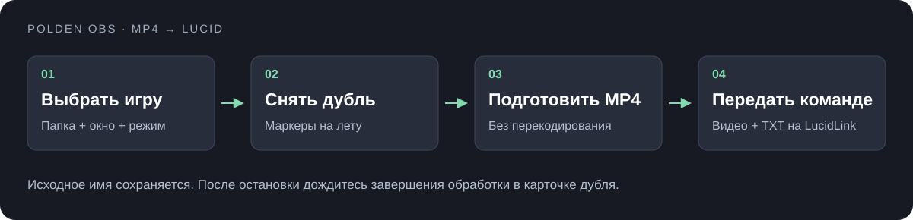
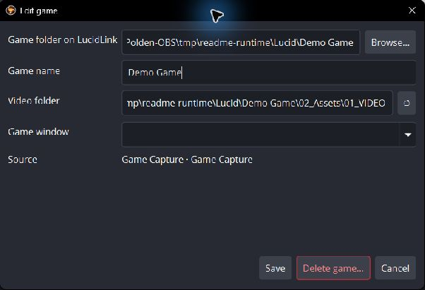
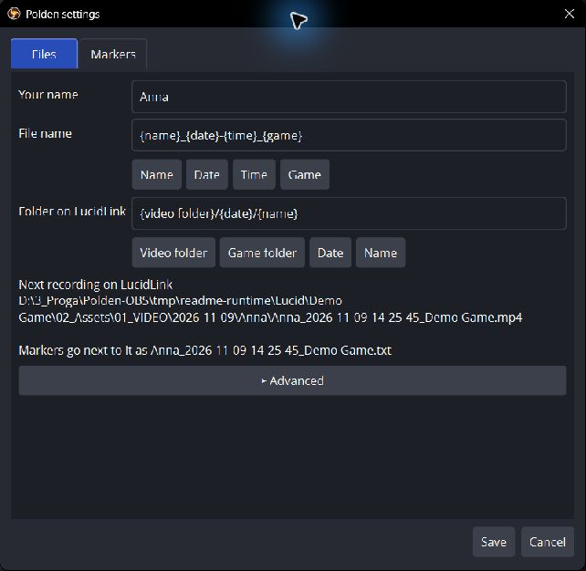
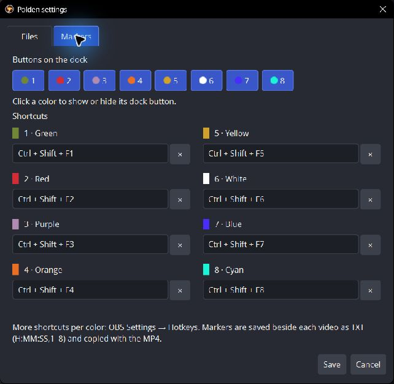
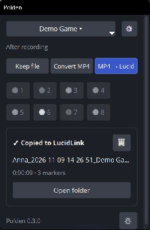
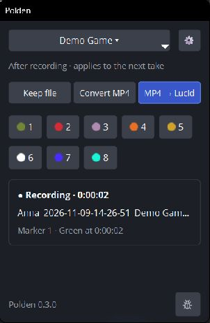

# Polden OBS — от игры до готовых футажей

**Вариант B · пошаговая инструкция со скриншотами.** [Сравнить варианты](../../../README.md#варианты-этой-инструкции)

Polden OBS нужен тем, кто снимает игровые футажи для команды: выбрать игру, записать дубль, отметить нужные моменты и передать MP4 с маркерами в папку проекта на LucidLink. Запись остаётся привычной, а подготовку и копирование файлов берёт на себя панель Polden.

[Скачать Windows x64](https://github.com/VslyDream/Polden-OBS/releases/latest) · [История версий](../releases.md) · [Помощь и ошибки](https://t.me/Vsly_Dream)



## 1. Установите и проверьте запись

Распакуйте ZIP целиком, запустите `Polden OBS/bin/64bit/obs64.exe`. На новой установке выбран пресет **Polden Gameplay**: Full HD, 60 FPS, NVENC HEVC Main10/CQP 22, fragmented MP4, одна дорожка игрового звука. Он требует совместимого NVIDIA NVENC. Если у вас другое оборудование, выберите подходящий кодировщик в OBS.

Проверьте превью, игровой звук и папку локальной записи. Сделайте короткую пробную запись до основной съёмки. Существующие профили и сцены при обновлении сохраняются.

## 2. Добавьте игру

В меню игры на панели Polden выберите **Add game…**. Для доставки нужен подключённый LucidLink с доступом на запись. Выберите корневую папку игры, проверьте автоматически предложенные имя и папку видео, затем источник захвата и окно игры.



**Что проверить на экране:** папка LucidLink — нужный проект; Video folder — место для футажей; Game Capture и окно — нужная игра. Если вы только записываете локально, LucidLink не обязателен.

## 3. Настройте имена и папки

Откройте **⚙ → Files**. Укажите своё имя в **Name**. В **File name** соберите шаблон кнопками **Name / Date / Time / Game**. В **Folder on LucidLink** задайте расположение готовых файлов; ниже проверьте пример полного пути.



**Advanced** содержит правила структуры папки игры и путь к FFmpeg. Для **Convert MP4** и **MP4 → Lucid** нужен рабочий `ffmpeg.exe`. Если он не найден автоматически, укажите его здесь. **Cancel** закроет настройки без сохранения.

## 4. Назначьте маркеры

Во вкладке **Markers** нажмите поле нужного цвета и задайте удобное сочетание. Клик по цветному чипу включает или скрывает кнопку на панели. Горячие клавиши работают и без видимой кнопки.



На новой установке кнопки и сочетания пусты. Подберите их так, чтобы не мешать игре и записи. В стандартном пресете **Alt+F1** уже запускает и останавливает запись. Одинаковое сочетание у разных цветов блокирует **Save**. Дополнительные назначения доступны в общей странице **OBS → Settings → Hotkeys**.

## 5. Выберите действие после записи



| На панели | Когда выбирать | Результат |
| --- | --- | --- |
| **Keep file** | Нужно оставить исходную запись | Исходник и TXT с маркерами, если они были. |
| **Convert MP4** | Нужен подготовленный локальный файл | MP4 и TXT рядом, без отправки на LucidLink. |
| **MP4 → Lucid** | Нужно передать дубль команде | MP4 и маркеры в папке выбранной игры. |

Подготовка MP4 — смена контейнера без перекодирования. Кодек остаётся исходным: HEVC не превращается в H.264. Имя, дата и время записи сохраняются.

## 6. Снимайте и отмечайте моменты

Начните запись кнопкой OBS или своим шорткатом. Удачный момент отмечайте цветом. Значение цветов договоритесь использовать одинаково внутри команды: приложение хранит цвет, но не навязывает смысл «удачно», «брак» или «переснять».



После остановки дождитесь завершения конвертации и копирования. Карточка показывает прогресс, результат или ошибку. **Open folder** открывает доступный результат. Новый дубль можно снимать, пока предыдущий обрабатывается; его прогресс появится отдельной строкой.

Игра и режим фиксируются в момент старта. Если изменить их во время записи, изменения применятся к следующему дублю.

## 7. Передайте видео и TXT вместе

```text
Anna_2026-11-09-14-32-10_Demo Game.mp4
Anna_2026-11-09-14-32-10_Demo Game.txt
```

TXT создаётся после первого маркера. Строка `0:01:24,1` означает время 1:24 и зелёный цвет. Номера 1–8: зелёный, красный, фиолетовый, оранжевый, жёлтый, белый, синий, бирюзовый. Паузы не входят во время; для сегментов отсчёт начинается заново. Автоматического импорта в Premiere нет.

## Ошибка, отмена и удаление

**Retry** повторяет обработку при ошибке — сначала проверьте подключение LucidLink, права и FFmpeg. Другой файл с тем же именем не перезаписывается. **Cancel** окончательно останавливает активную обработку и незавершённую очередь; исходники и готовые файлы остаются.

**Delete last take…** относится ко всем сегментам последнего дубля выбранной игры. Локальные файлы отправляются в Корзину, копии LucidLink удаляются насовсем. Прочитайте список перед подтверждением. **Delete game…** убирает игру из списка, сохраняя файлы.

Обновления доступны через плашку версии в Polden и меню Help. Существующие настройки сохраняются. Обновляйтесь, когда запись и обработка закончены.

---

Скриншоты настоящего интерфейса 0.3.0; учебная игра и отдельные настройки. На снимках тестовая локальная папка заменяет LucidLink. [Короткая памятка](../../../README.md) · [Вариант с GIF](README-gifs.md) · [Техническая документация](../../../POLDEN.md)
