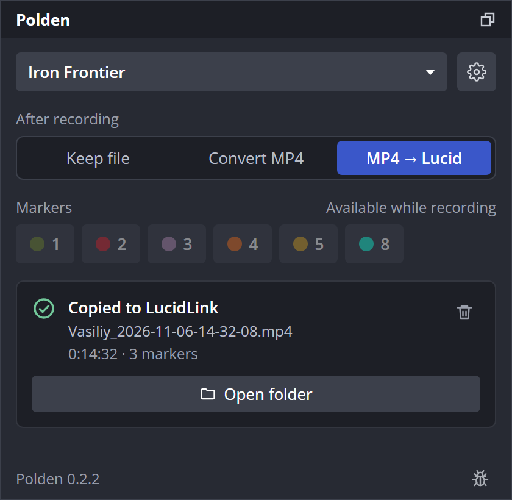
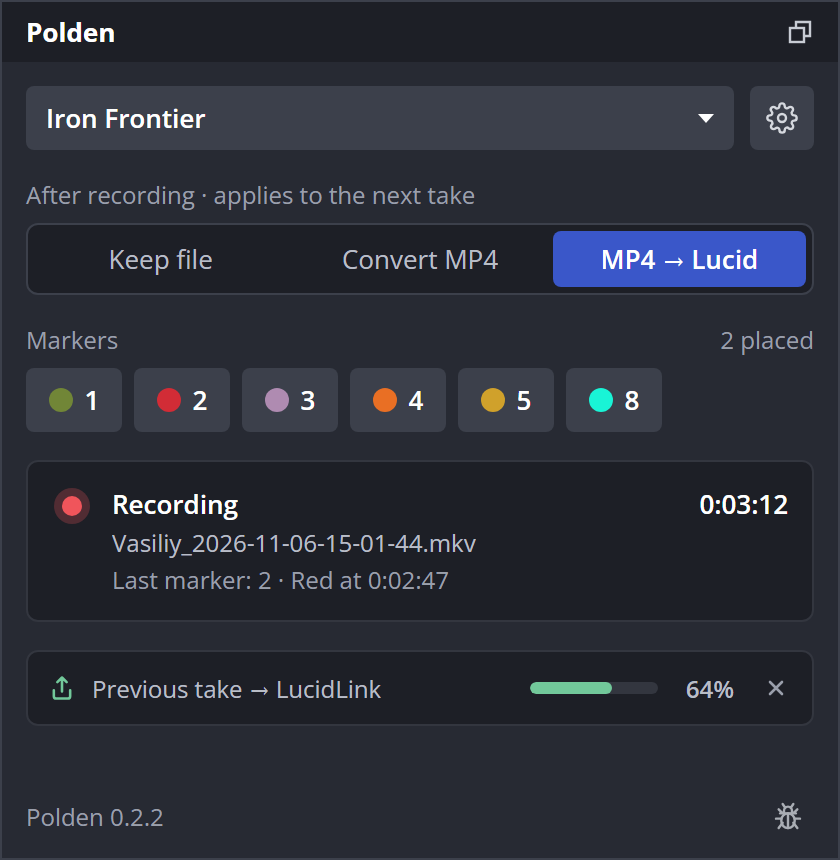
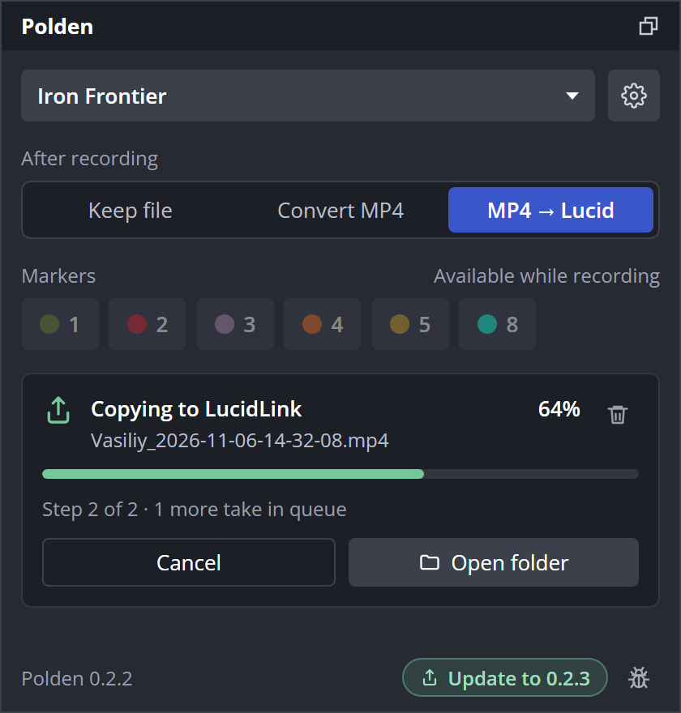
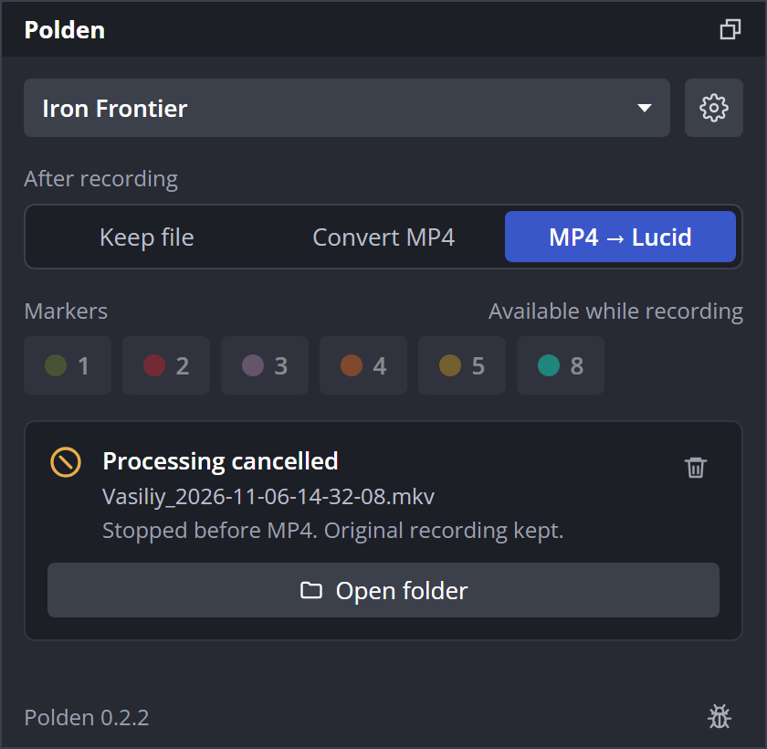
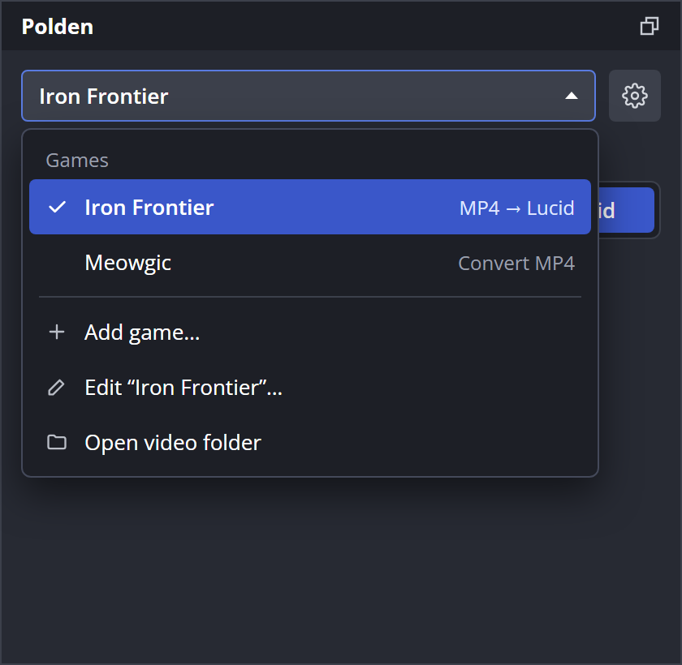
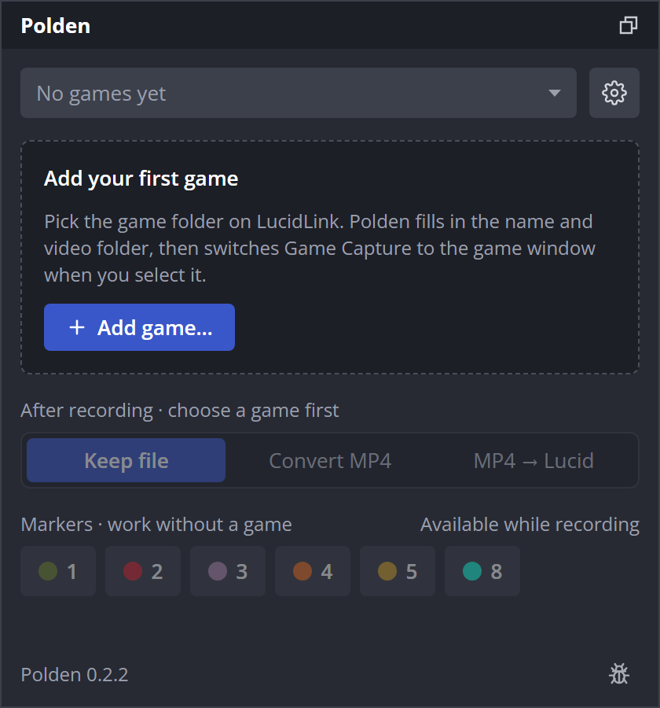
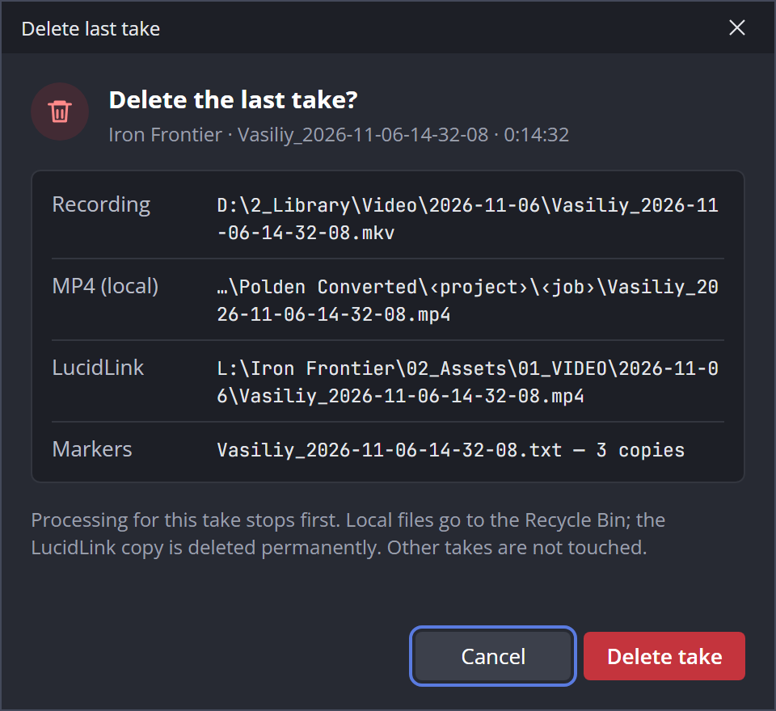
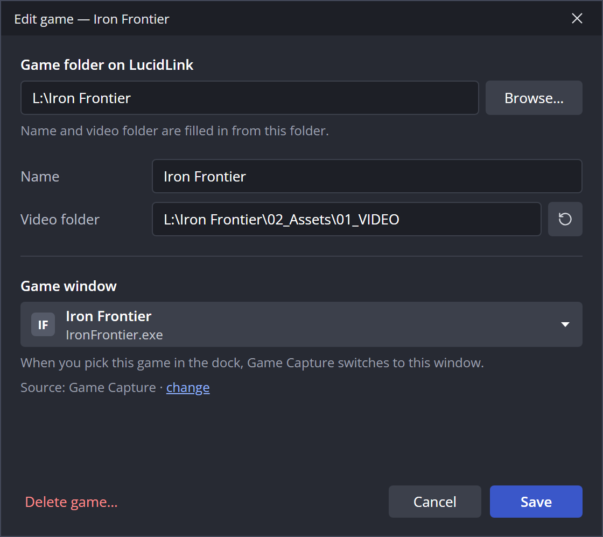
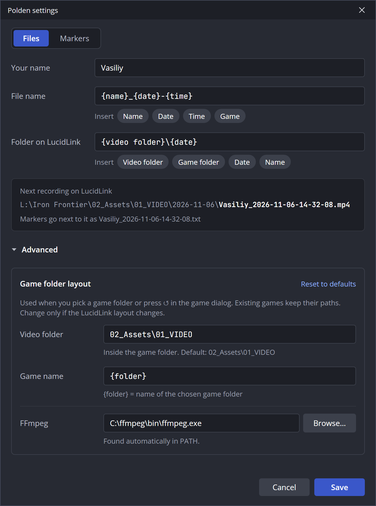
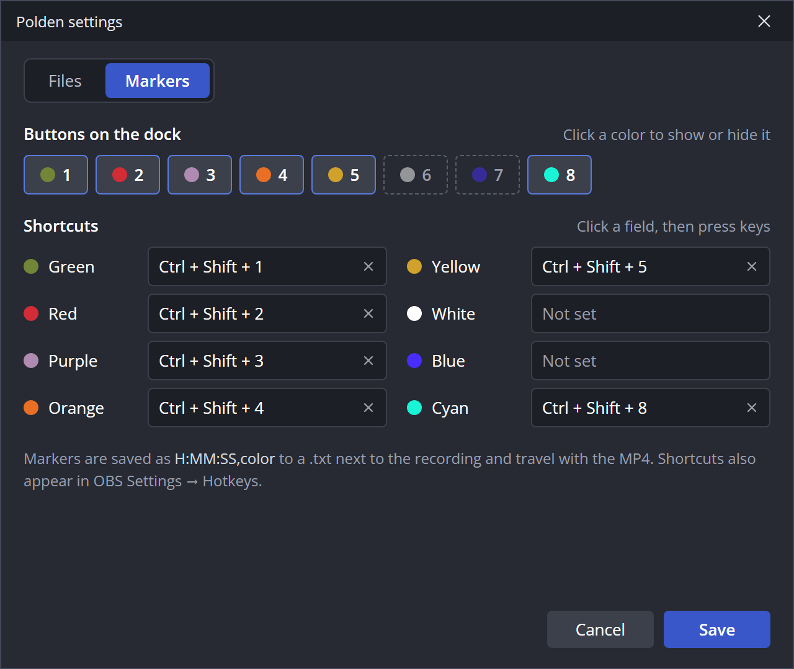

# Редизайн интерфейса Polden — вариант A

Статус: **дизайн утверждён, в коде не реализован**. Описан интерфейс, который должен заменить док и диалоги Polden 0.2.2. Функциональность сохраняется: меняются компоновка, подписи и несколько правил поведения (см. «Новое поведение»).

Экраны лежат в [`ui/`](ui/): HTML-макеты с кодом (`ui/*.html`), PNG-снимки в 2× (`ui/png/*.png`) и галерея всех экранов [`ui/index.html`](ui/index.html). Цвета и размеры в HTML — эталон для Qt-стилей. Исходный холст с текущим UI, вариантами A/B/C и финалом: [Polden OBS — UI](https://claude.ai/artifact/He3TzeXcDTCcfFPy6aE927) (доступ по приглашению).

## Что меняется

| Было (0.2.2) | Стало |
| --- | --- |
| Строка «игра ▾ + Edit» | Игра ▾ и ⚙. **Add game…**, **Edit…**, **Open video folder** — внутри списка игр |
| `Automation: 0 · OBS only / 1 · Convert MP4 / 2 · LucidLink` | **After recording**: три кнопки **Keep file / Convert MP4 / MP4 → Lucid** |
| Кнопки маркеров `1 · Green` во всю ширину | Компактные цветные чипы с номером; имя и шорткат — в подсказке. Вне записи приглушены |
| Строка статуса + **Open files folder** + **Retry / Resume** + **Cancel processing** | Одна карточка последнего дубля: значок, состояние, файл, прогресс и только нужные сейчас кнопки |
| **Resume cancelled job** | Удалено. Отмена окончательная. **Retry** остаётся только для ошибок |
| — | Новое: **Delete last take** — значок корзины в углу карточки, с подтверждением |
| **Polden settings…** во всю ширину | Значок ⚙ рядом с выбором игры |
| Значок обновления | Зелёная плашка **Update to X.Y.Z** в подвале |
| Вкладка **General** | Вкладка **Files**: шаблоны с кнопками вставки, один пример пути, свёрнутый **Advanced** |
| Вкладка **Markers**: 8 строк, у каждой Revert / Clear / + / − и галочка | Ряд из 8 цветов (клик — показать/скрыть кнопку в доке) и шорткаты в две колонки с × |
| Диалог проекта с **Detect paths** и сырой строкой окна | Диалог игры: папка игры → имя и папка видео подставляются сами; ↺ вместо Detect paths; окно — «заголовок / exe»; **Delete game…** |

## Док

Сверху вниз три зоны: **настройка** (игра, что делать после записи) → **во время записи** (маркеры) → **результат** (карточка дубля). Ширина макетов 420 px; док должен работать от ~320 px — чипы маркеров переносятся, карточка тянется.

| Экран | Состояние |
| --- | --- |
|  | **Готово.** Дубль скопирован на LucidLink. В карточке: файл, длительность, число маркеров, **Open folder**, корзина. |
|  | **Новая запись, прошлый дубль ещё копируется.** Запись — главное: маркеры активны, карточка показывает запись. Обработка прошлого дубля сжата в строку под карточкой: шаг, прогресс, × (Cancel processing). |
|  | **Обработка без записи.** Шаг, процент, полоса, «Step 2 of 2 · 1 more take in queue», **Cancel** и **Open folder**. В подвале — плашка обновления. |
|  | **Отменено.** Исходник сохранён. Кнопки возобновления нет; доступны **Open folder** и корзина. |
|  | **Меню игр.** Список игр с режимом каждой, затем **Add game…**, **Edit “…”…**, **Open video folder**. |
|  | **Нет игр.** Карточка-приглашение с **Add game…**. Режим недоступен, маркеры работают и без игры. |

### Состояния карточки

| Состояние | Значок и заголовок | Строки | Кнопки |
| --- | --- | --- | --- |
| Нет записей | — | «No recordings yet» | **Open folder** |
| Запись | Красная точка, **Recording**, таймер | Имя файла, последний маркер | — |
| Конвертация | **Converting to MP4**, % | Файл, полоса, шаг, очередь | **Cancel**, **Open folder**, корзина |
| Копирование | **Copying to LucidLink**, % | То же | То же |
| Готово | ✓ **Copied to LucidLink** / **Converted** / **Saved** (по режиму) | Файл, длительность, маркеры | **Open folder**, корзина |
| Отменено | ⊘ **Processing cancelled** | Файл, «Original recording kept» | **Open folder**, корзина |
| Ошибка | ⚠ **Copy failed** / **Conversion failed** | Файл, текст ошибки | **Retry**, **Open folder**, корзина |

Во время записи предыдущий дубль никогда не занимает карточку: он показывается строкой под ней. Когда запись остановлена, строка исчезает, карточка переходит к новому дублю.

Подпись над режимом во время записи — **After recording · applies to the next take**: игра и режим фиксируются при старте записи, как и сейчас.

### Удаление последнего дубля

- Корзина — значок без подписи в правом верхнем углу карточки (подсказка **Delete last take…**). Её нет во время записи этого дубля.
- «Последний дубль» — последнее задание выбранной игры. Если запись разбита на сегменты, удаляются все сегменты этой записи.
- Подтверждение обязательно. Диалог перечисляет всё, что будет удалено: исходник, локальный MP4 из `Polden Converted`, копию на LucidLink, TXT/CSV маркеров. Кнопка по умолчанию (Enter, Esc) — **Cancel**; удаление — красной кнопкой **Delete take**.
- Если дубль ещё обрабатывается, обработка сначала отменяется, временные файлы удаляются.
- Локальные файлы уходят в Корзину Windows (`QFile::moveToTrash`). Копия на LucidLink удаляется насовсем: у сетевого диска нет Корзины.
- Другие дубли и задания других игр не затрагиваются. После удаления карточка показывает предыдущий дубль игры или «No recordings yet».

## Диалог игры

- Первое поле — **Game folder on LucidLink**. После выбора имя и папка видео заполняются по правилам из **Advanced**; ↺ рядом с папкой видео пересчитывает её заново (замена Detect paths).
- **Game window** показывает заголовок и exe, а не сырую строку OBS `title:class:exe`.
- Источник Game Capture — строкой «Source: Game Capture · change»; выбор списком нужен только при нескольких источниках.
- **Delete game…** удаляет игру из списка после подтверждения. Файлы и уже созданные задания не трогаются.
- Для новой игры заголовок **Add game**, кнопка **Add game**, без Delete.

## Polden settings → Files

- **Your name** — одно имя для файла и папки (`{name}`). Сейчас Recorder name влияет только на `{user}` в папке, а имя в шаблоне OBS вписано вручную.
- **File name** — шаблон с кнопками вставки **Name / Date / Time / Game**. В профиль OBS (`[Output] FilenameFormatting`) он записывается в формате OBS: `{date}` → `%CCYY-%MM-%DD`, `{time}` → `%hh-%mm-%ss`, `{name}` и `{game}` — текстом. Во время записи поле недоступно, как сейчас.
- **Folder on LucidLink** — шаблон с кнопками **Video folder / Game folder / Date / Name**: `{video folder}` = `{footage}`, `{game folder}` = `{root}`, `{name}` = `{user}`. Старые токены продолжают работать.
- Один пример полного пути с обратными слэшами Windows и строка про TXT маркеров.
- **Advanced** (по умолчанию свёрнут):
  - **Game folder layout → Video folder** — путь папки видео внутри папки игры, по умолчанию `02_Assets\01_VIDEO`. Нужен, если на LucidLink поменяется структура (например, `02_VIDEO`).
  - **Game name** — формула имени игры, по умолчанию `{folder}` (имя выбранной папки).
  - **Reset to defaults** возвращает оба значения.
  - Правила применяются при выборе папки игры и по ↺; пути существующих игр не меняются.
  - **FFmpeg** — путь, найденный автоматически, и Browse….

## Polden settings → Markers

- **Buttons on the dock** — 8 цветов в том виде, как они появятся в доке. Клик включает/выключает кнопку (`showButton`).
- **Shortcuts** — по полю на цвет, две колонки 1–4 и 5–8. Клик и нажатие клавиш задают сочетание, × очищает. Revert / + / − убраны; несколько сочетаний на цвет по-прежнему можно задать на общей странице OBS **Hotkeys**.
- Повтор одного сочетания для разных цветов подсвечивает оба поля и блокирует **Save** (сейчас — текст ошибки).
- Внизу — куда пишутся маркеры.

## Что сделать в коде

- `frontend/widgets/PoldenPanel.cpp` — новая компоновка дока:
  - Выбор игры — `QToolButton` с `QMenu`.
  - Режим — `QButtonGroup` из трёх checkable-кнопок.
  - Карточка последнего дубля и строка обработки во время записи — отдельный виджет.
  - ⚙ и плашка обновления, `PoldenUpdater` получает плашку вместо иконки.
- Прогресс в %:
  - FFmpeg — `-progress pipe:1`, `out_time_ms` относительно длительности записи.
  - Копирование — колбэк байтов в `PoldenFileTransfer::copyVerified`.
  - Пока прогресса нет, полоса — бегущая, без процента.
- Отмена без возобновления: убрать **Resume cancelled job**, отменённые задания больше не поднимаются. **Retry** — только для `error`. Сохранённые отменённые задания остаются отменёнными.
- **Delete last take** — новая операция над последним заданием игры: отмена обработки, удаление файлов по правилам выше, удаление задания из `polden-jobs.json`.
- **Delete game** — удаление проекта из `polden.json`.
- Настройки: `videoSubfolder` (по умолчанию `02_Assets/01_VIDEO`) и `gameNameTemplate` (`{folder}`) в `polden.json`; их использует автозаполнение диалога игры.
- Шаблоны Files:
  - Преобразование токенов в формат OBS и обратно.
  - `{game}` в имени файла нужно подставлять в `FilenameFormatting` при смене игры или перед стартом записи.
  - Пример пути — через `QDir::toNativeSeparators` (сейчас слэши смешаны).
- `PoldenMarkerSettings`: чипы видимости и упрощённое поле шортката поверх `OBSHotkeyWidget`.
- Документацию [проектов и пайплайна](project-pipeline.md), [маркеров](markers.md) и [версий](releases.md) обновить при реализации.

## Открытые вопросы

- Нужна ли Корзина для локальных файлов или достаточно удаления насовсем, как на LucidLink.
- Номер версии, в которой выйдет редизайн. В макетах оставлена текущая `0.2.2`.
